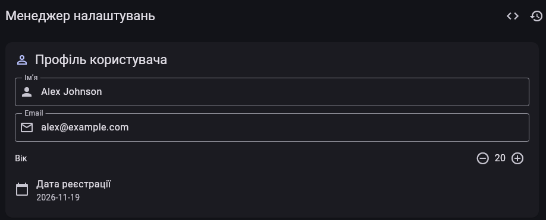
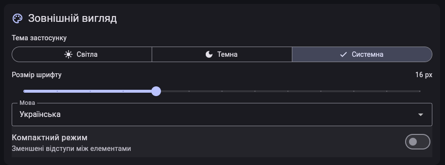
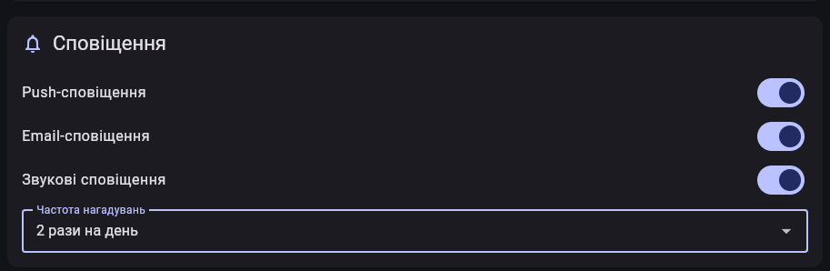
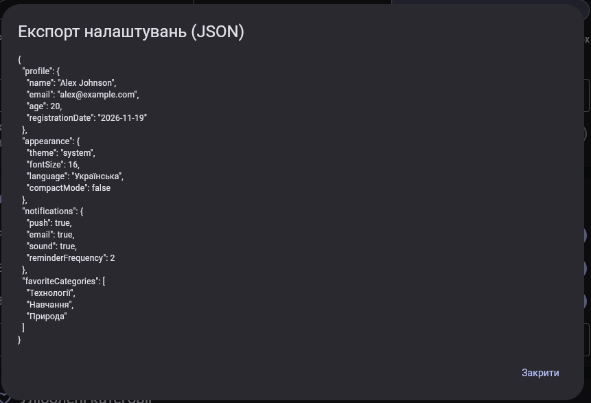

#  Settings Manager

**Практична робота № 9.1 — Робота з SharedPreferences у Flutter**  
**Варіант 1**

Мобільний застосунок для керування персональними налаштуваннями користувача з використанням локального сховища `SharedPreferences`.

Застосунок підтримує автоматичне збереження даних, зміну зовнішнього вигляду, керування сповіщеннями та редагування улюблених категорій. Налаштування зберігаються між запусками застосунку.

---

##  Можливості

| Розділ | Функціональність |
|---|---|
|  Профіль | Ім'я, email, вік, дата реєстрації |
|  Зовнішній вигляд | Світла, темна та системна тема; розмір шрифту; мова; компактний режим |
|  Сповіщення | Push, Email, звук та частота нагадувань |
|  Категорії | Додавання, перегляд і видалення улюблених категорій |
|  Збереження | Автоматичне збереження та відновлення налаштувань |
|  Експорт | Перегляд налаштувань у форматі JSON |
|  Скидання | Повернення до початкових налаштувань |

##  Інтерфейс застосунку

**Профіль користувача та зовнішній вигляд**





**Сповіщення та категорії**




**Додаткові можливості**




##  Технології

- **Flutter** — розробка інтерфейсу.
- **Dart** — мова програмування.
- **SharedPreferences 2.2.2** — локальне збереження налаштувань.
- **Material 3** — компоненти інтерфейсу.
- **Flutter Test** — автоматизоване тестування.

##  Структура проєкту

```text
lib/
├── main.dart
├── models/
│   └── user_settings.dart
├── screens/
│   └── settings_screen.dart
├── services/
│   └── preferences_manager.dart
├── utils/
│   └── settings_exporter.dart
└── widgets/
    ├── appearance_section.dart
    ├── categories_section.dart
    ├── notifications_section.dart
    ├── profile_section.dart
    └── settings_section.dart

test/
└── widget_test.dart

screenshots/
```

##  Архітектура

| Компонент | Призначення |
|---|---|
| `UserSettings` | Модель даних користувача та його налаштувань |
| `PreferencesManager` | Singleton-сервіс для CRUD-операцій із SharedPreferences |
| `SettingsScreen` | Головний екран та керування налаштуваннями |
| `widgets/` | Окремі компоненти інтерфейсу |
| `SettingsExporter` | Формування JSON-представлення налаштувань |

Для обробки помилок операцій зі сховищем використовується `try-catch`. Зміни стану застосунку відображаються в інтерфейсі одразу після взаємодії користувача.

##  Запуск

**1. Клонування репозиторію**

```bash
git clone https://github.com/Kiter0/Programming-Mobile-Platforms.git
```

**2. Перехід до директорії проєкту**

```bash
cd Programming-Mobile-Platforms/practice_09_shared_preferences
```

**3. Встановлення залежностей**

```bash
flutter pub get
```

**4. Запуск**

```bash
flutter run
```

##  Перевірка

Для перевірки та аналізу проєкту використовуються:

```bash
dart format lib test
flutter analyze
flutter test
```

Перевірено відображення основних розділів, роботу віджетів, взаємодію з налаштуваннями та додавання категорій.

##  Труднощі під час розробки

Під час реалізації було виправлено проблеми з масштабуванням тексту в нових версіях Flutter та життєвим циклом віджетів під час додавання категорій.

Для масштабування тексту використано `MediaQuery` з `TextScaler`, а для введення нових категорій — діалогове вікно з безпечним отриманням результату.


##  Використання ШІ

Під час виконання роботи використовувався **ChatGPT (OpenAI)**.

**Мета використання:** консультації щодо архітектури Flutter-застосунку, реалізації роботи з `SharedPreferences`, створення UI-компонентів, виправлення помилок і підготовки документації.

**Приклади запитів:**
- Допомога з реалізацією Singleton-сервісу для збереження налаштувань.
- Розділення головного екрана на окремі віджети.
- Пошук і виправлення помилок під час роботи застосунку.

Згенеровані фрагменти коду були використані як основа окремих частин проєкту, після чого адаптовані та перевірені під час запуску й тестування. Інтеграція компонентів, перевірка функціональності та підготовка проєкту до здачі виконувалися в межах роботи над практичним завданням.